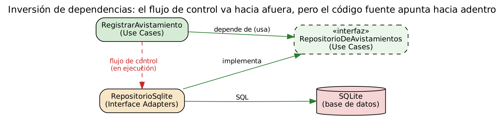
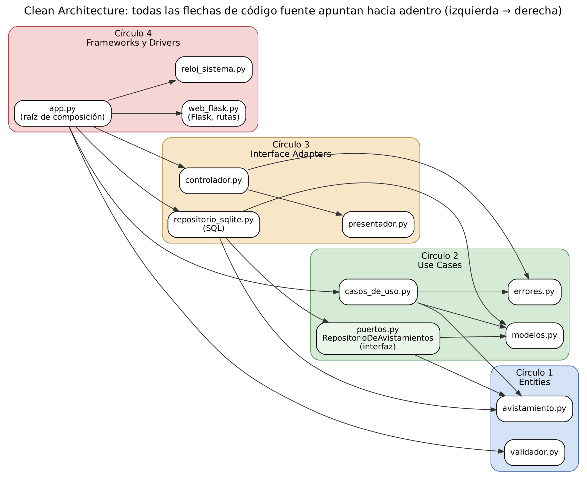

# Taller 5: Clean Architecture y arquitectura hexagonal

**Ingeniería de Software 2 (ISW-2)** · Trabajo individual · Miércoles 11 de noviembre de 2026
**Paula Buitrago Velandia**

---

# Parte 1. Investigación

## Pregunta 1. Cockburn (2005): el problema, los puertos y los adaptadores

**El problema.** Cockburn ve que en las aplicaciones de su época la lógica de negocio se va metiendo en el código de la interfaz de usuario (Cockburn, 2005). Eso trae tres problemas: la aplicación no se puede probar con pruebas automáticas, porque parte de la lógica depende de detalles visuales; no se puede pasar a un uso por lotes sin una persona; y tampoco se puede dejar que otro programa la maneje (Cockburn, 2005). Agregar una capa nueva no lo arregla, porque nada avisa cuando alguien rompe la promesa de no poner lógica ahí, y años después la lógica reaparece en esa capa (Cockburn, 2005). Del otro lado de la aplicación pasa algo parecido: si la lógica queda atada a la base de datos, cuando esta se cae o se reemplaza los programadores no pueden trabajar (Cockburn, 2005).

**Puerto y adaptador.** Un puerto es el punto por donde la aplicación tiene una conversación con algo de afuera; se define por el propósito de esa conversación y toma la forma de una API (Cockburn, 2005). Un adaptador es la pieza que se conecta a ese puerto para una tecnología concreta: traduce lo que entiende el dispositivo externo a la API del puerto, y al revés (Cockburn, 2005). Por ejemplo, una interfaz gráfica, un programa de pruebas automáticas o un proceso por lotes son adaptadores distintos para el mismo puerto del lado del usuario; del lado de los datos, un adaptador SQL, uno de archivo plano o uno falso en memoria (*mock*) son adaptadores distintos para el mismo puerto de la base de datos (Cockburn, 2005).

**La simetría.** Cockburn dice que los dos problemas (la lógica metida en la interfaz y la lógica atada a la base de datos) vienen del mismo error de diseño: enredar la lógica de negocio con la interacción con cosas externas (Cockburn, 2005). Por eso la diferencia importante no es izquierda contra derecha, sino adentro contra afuera. Desde la aplicación, el usuario y la base de datos son externos y se tratan igual: cada uno se conecta por un puerto y se puede cambiar por otro adaptador sin tocar lo de adentro (Cockburn, 2005).

## Pregunta 2. Martin (2012): los círculos y la regla de dependencia

**Qué va en cada círculo** (de adentro hacia afuera) (Martin, 2012):

| Círculo | Qué contiene |
|---|---|
| 1. Entities | Las reglas de negocio más generales. Si solo hay una aplicación, son los objetos de negocio de esa aplicación. Son lo que menos cambia cuando algo externo cambia. |
| 2. Use Cases | Las reglas de negocio propias de la aplicación. Orquestan el flujo de datos hacia y desde las entidades. |
| 3. Interface Adapters | Adaptadores que convierten los datos del formato cómodo para casos de uso y entidades al formato cómodo para algo externo (la web, la base de datos). Aquí van los controladores, los presentadores y todo el SQL. |
| 4. Frameworks and Drivers | Las herramientas: la base de datos, el framework web. Casi todo es código de pegamento hacia el círculo de adentro. |

Martin aclara que los círculos son un esquema y que se pueden necesitar más de cuatro; lo que no cambia es la regla (Martin, 2012).

**La regla de dependencia.** Dice que las dependencias del código fuente solo pueden apuntar hacia adentro (Martin, 2012). Lo que prohíbe es que el código de un círculo interno conozca algo de un círculo externo: no puede mencionar el nombre de nada declarado afuera (funciones, clases, variables), ni usar formatos de datos del círculo externo, sobre todo si los genera un framework (Martin, 2012).

## Pregunta 3. ¿Cómo guarda datos un caso de uso si no puede depender de la base de datos?

El problema es que el flujo de control sí va hacia afuera (el caso de uso necesita que alguien guarde), pero la regla dice que el código fuente no puede apuntar hacia afuera. Martin lo resuelve con el principio de inversión de dependencias: el caso de uso llama a una interfaz que está declarada en su mismo círculo, y el círculo de afuera es el que implementa esa interfaz (Martin, 2012). Él lo explica con el presentador, pero aclara que la misma técnica sirve para cruzar todas las fronteras (Martin, 2012). Palermo lo describe igual para la base de datos: en el núcleo solo queda la interfaz del repositorio, y la clase que la implementa y conoce el método de acceso a datos queda en el borde (Palermo, 2008).

**Ejemplo en mi API.** `RegistrarAvistamiento` (círculo 2) necesita guardar. No llama a SQLite: llama a `repositorio.guardar(...)`, donde `repositorio` es del tipo `RepositorioDeAvistamientos`, una interfaz que está en `use_cases/puertos.py`. La clase `RepositorioSqlite` (círculo 3) implementa esa interfaz y es la única que tiene SQL. Quien conecta las dos es `app.py`, que le pasa el repositorio al caso de uso por el constructor.

```python
# use_cases/casos_de_uso.py (círculo 2): no sabe qué base de datos hay
class RegistrarAvistamiento:
    def __init__(self, repositorio, validador): ...
    def ejecutar(self, datos):
        ...
        return _a_salida(self._repositorio.guardar(nuevo))

# interface_adapters/repositorio_sqlite.py (círculo 3): implementa el puerto
class RepositorioSqlite(RepositorioDeAvistamientos):
    def guardar(self, avistamiento): ...   # aquí está el INSERT
```



Así el flujo de control va del caso de uso al repositorio SQLite, pero las flechas del código fuente apuntan las dos hacia la interfaz que está adentro. Además, Martin pide que por las fronteras crucen datos simples y no filas de la base de datos ni entidades (Martin, 2012). Por eso `RepositorioSqlite` convierte las filas en `Avistamiento` y los casos de uso devuelven `AvistamientoSalida`, una estructura simple.

## Pregunta 4. Hexagonal, cebolla y Clean Architecture

**Qué tienen en común.** Martin (2012) dice que estas arquitecturas varían en los detalles pero se parecen mucho: comparten el objetivo de separar responsabilidades, lo hacen dividiendo el software en capas, y todas tienen al menos una capa para las reglas de negocio y otra para las interfaces. También coinciden en el resultado: reglas de negocio que se pueden probar sin la interfaz ni la base de datos, y que no dependen de frameworks (Martin, 2012). Palermo (2008) lo resume para la hexagonal y la de cebolla: ambas parten de sacar la infraestructura del centro y escribir adaptadores para que no quede acoplada.

**Qué cambia.**

| | Hexagonal (Cockburn, 2005) | Cebolla (Palermo, 2008) | Clean Architecture (Martin, 2012) |
|---|---|---|---|
| Vocabulario | Puertos y adaptadores; aplicación adentro, mundo externo afuera | Modelo de dominio al centro; interfaces de repositorio; UI, infraestructura y pruebas en el borde | Entities, Use Cases, Interface Adapters, Frameworks and Drivers |
| Forma y número de capas | No son capas: hay un adentro y un afuera, con 2 a 4 puertos; el hexágono solo da espacio para dibujarlos | Círculos concéntricos; el número de capas del núcleo varía, y el modelo de dominio siempre es el centro | Cuatro círculos, pero dice que son un esquema y puede haber más |
| Regla central | Lo de adentro no debe filtrarse hacia afuera; la aplicación solo habla con puertos | Todo el acoplamiento va hacia el centro; el código puede depender de capas más centrales, nunca de las de afuera | La regla de dependencia: el código fuente solo apunta hacia adentro |
| Énfasis | Que la aplicación pueda ser manejada por usuarios, programas o pruebas, y funcionar sin la base de datos real | Que la base de datos no es el centro, es externa; usa inversión de dependencias | Qué va en cada círculo y qué datos cruzan las fronteras (datos simples, no entidades ni filas) |

Entonces el vocabulario sí cambia, el número de capas cambia (o ni siquiera se habla de capas, en el caso de Cockburn), y también cambia en qué insiste cada autor. La idea de fondo es la misma.

## Pregunta 5. ¿Se justifica Clean Architecture en esta API?

**Mi posición:** para una API de este tamaño, aplicar Clean Architecture completa no se justifica si la API se queda como está. Lo que sí se justifica es la parte barata: tener la regla de validación aparte y el acceso a datos detrás de una interfaz. Hacerla completa en este taller tiene sentido como ejercicio, y si la API crece ya queda lista.

**Un costo concreto.** Hay más código y más archivos para hacer lo mismo. Antes la API eran 2 archivos de código (`app.py` y `validador.py`, 164 líneas); ahora son 12 archivos (492 líneas, contando comentarios y docstrings). Un cambio pequeño cuesta más: agregar un campo nuevo (por ejemplo `hora`) antes obligaba a tocar 2 archivos y ahora obliga a tocar 6 (`avistamiento.py`, `validador.py`, `modelos.py`, `casos_de_uso.py`, `presentador.py` y `repositorio_sqlite.py`). Palermo (2008) lo advierte: dice que su arquitectura no es apropiada para sitios pequeños, sino para aplicaciones de negocio de larga vida o con comportamiento complejo.

**Un beneficio concreto.** Los casos de uso se pueden probar sin Flask y sin base de datos. Hice 11 pruebas con un repositorio en memoria, y al cargarlas no se importa ni `flask` ni `sqlite3`. Esto es lo que Cockburn (2005) busca con el adaptador de base de datos falso en memoria: poder probar la aplicación aislada. Además, la regla de dependencia se puede verificar con una prueba automática (`tests/test_arquitectura.py`, que lee los `import` y falla si una capa importa de otra más externa). Cockburn (2005) decía que a las capas les faltaba justo un mecanismo para detectar cuándo se rompe la separación.

**Por qué esa posición.** Hoy el beneficio es pequeño porque la API tiene una sola regla de validación, una sola base de datos y una sola forma de entrada (HTTP), mientras que el costo se paga desde el primer día. El beneficio grande llega si aparece un segundo adaptador (otra base de datos, una consola, un proceso por lotes) o si las reglas de negocio crecen. En ese caso, cambiar SQLite por otra cosa significaría escribir una clase nueva que implemente `RepositorioDeAvistamientos`, y los casos de uso no cambiarían.

## Referencias

- Cockburn, A. (2005). *Hexagonal architecture*. https://alistair.cockburn.us/hexagonal-architecture/
- Martin, R. C. (2012). *The Clean Architecture*. The Clean Code Blog. https://blog.cleancoder.com/uncle-bob/2012/08/13/the-clean-architecture.html
- Palermo, J. (2008). *The Onion Architecture: part 1*. Programming with Palermo. https://jeffreypalermo.com/2008/07/the-onion-architecture-part-1/

---

# Parte 2. Aplicación

## 1. Repositorio

- Repositorio: https://github.com/PauliIi1/API-REST (el mismo de la entrega anterior)
- Rama: `taller5-clean-architecture`

Los cambios están en varios commits, uno por cada paso del refactor (ver `git log`):

1. Línea base y corrección del `.gitignore` (el "antes").
2. Refactor 1/6: círculo Entities.
3. Refactor 2/6: círculo Use Cases (casos de uso, errores, datos simples y puerto del repositorio).
4. Refactor 3/6: círculo Interface Adapters (repositorio SQLite, presentador y controlador).
5. Refactor 4/6: las lecturas de la API pasan por el controlador y los casos de uso.
6. Refactor 5/6: las escrituras también.
7. Refactor 6/6: Flask sale al círculo exterior; `app.py` queda como raíz de composición.
8. Pruebas nuevas de casos de uso y de la regla de dependencia.
9. README.
10. Documento del taller (este archivo), diagramas y evidencia.

## 2. Arquitectura elegida y organización del código

**Elegí Clean Architecture (Martin, 2012).** La elegí porque su vocabulario (entidades, casos de uso, adaptadores, frameworks) se corresponde directamente con lo que ya tenía la API: la regla de validación es una entidad, cada endpoint es un caso de uso, el SQL es un adaptador y Flask es un framework. Usé los nombres de Martin para las carpetas y respeté la regla de dependencia en todo el código, sin mezclar vocabulario de las otras dos.

### Estructura de carpetas

```
API-REST/
├── app.py                                  raíz de composición (arma y conecta las piezas)
├── avistamientos/
│   ├── entities/                           CÍRCULO 1
│   │   ├── avistamiento.py                 la entidad Avistamiento
│   │   └── validador.py                    la regla de negocio (ValidadorDeAvistamiento)
│   ├── use_cases/                          CÍRCULO 2
│   │   ├── casos_de_uso.py                 Listar, Ver, Registrar, Actualizar, Eliminar, Resumen
│   │   ├── puertos.py                      interfaz RepositorioDeAvistamientos
│   │   ├── modelos.py                      datos simples que cruzan la frontera
│   │   └── errores.py                      DatosInvalidos, AvistamientoNoEncontrado
│   ├── interface_adapters/                 CÍRCULO 3
│   │   ├── controlador.py                  llama al caso de uso y decide el código HTTP
│   │   ├── presentador.py                  da formato a la salida
│   │   └── repositorio_sqlite.py           implementa el puerto; todo el SQL
│   └── frameworks_and_drivers/             CÍRCULO 4
│       ├── web_flask.py                    rutas de Flask
│       └── reloj_sistema.py                la fecha de hoy del computador
├── tests/
│   ├── test_api.py                         integración (las del taller anterior)
│   ├── test_validador.py                   unitarias del validador (las del taller anterior)
│   ├── test_casos_de_uso.py                nuevas: casos de uso sin Flask ni SQLite
│   ├── test_arquitectura.py                nuevas: verifican la regla de dependencia
│   ├── repositorio_en_memoria.py           otro adaptador para el mismo puerto
│   └── relojes.py                          reloj falso para pruebas
├── scripts/muestra_api.sh                  secuencia de peticiones para comparar antes y después
└── docs/                                   este documento, diagramas y evidencia
```

### Diagrama de dependencias



Todas las flechas apuntan hacia adentro (de izquierda a derecha). Las entidades no importan nada del proyecto. Los casos de uso solo importan entidades y cosas de su mismo círculo. `app.py` es el único que conoce todos los círculos, porque es el que arma las piezas. Esto no es solo un dibujo: `tests/test_arquitectura.py` lo comprueba leyendo los `import` de cada archivo.

### Cómo viaja una petición

`POST /avistamientos` → `web_flask.py` (lee el JSON) → `ControladorDeAvistamientos.crear` → `RegistrarAvistamiento.ejecutar` (valida con la entidad y llama al puerto) → `RepositorioSqlite.guardar` (INSERT) → vuelve el dato simple → `presentador` → `web_flask.py` arma la respuesta 201. Si los datos no son válidos, el caso de uso lanza `DatosInvalidos` y el controlador lo convierte en 400.

## 3. Evidencia de funcionamiento y de cobertura

Salidas generadas con Python 3.12.3 y pytest 9.2.0. Los archivos completos están en `docs/evidencia/`.

### Antes del refactor (commit de línea base)

Comando: `python -m pytest -v`

```
============================= test session starts ==============================
platform linux -- Python 3.12.3, pytest-9.2.0, pluggy-1.7.0 -- /usr/bin/python
...
============================== 28 passed in 0.21s ==============================
```

Resultado: **28 pruebas, todas pasan.** (La salida completa con los nombres de las 28 pruebas está en el anexo.)

Comando: `python -m pytest --cov=app --cov=validador --cov-report=term-missing`

```
Name           Stmts   Miss  Cover   Missing
--------------------------------------------
app.py            76      2    97%   99-100
validador.py      45      0   100%
--------------------------------------------
TOTAL            121      2    98%
============================== 28 passed in 0.36s ==============================
```

### Después del refactor

Comando: `python -m pytest -v`. Resultado: **64 pruebas, todas pasan** (las 28 de antes más 36 nuevas: 11 de casos de uso y 25 de arquitectura). Salida completa en el anexo.

Comando: `python -m pytest --cov=app --cov=avistamientos --cov-report=term-missing`

```
Name                                                     Stmts   Miss  Cover   Missing
--------------------------------------------------------------------------------------
app.py                                                      15      1    93%   38
avistamientos/__init__.py                                    0      0   100%
avistamientos/entities/__init__.py                           0      0   100%
avistamientos/entities/avistamiento.py                      10      0   100%
avistamientos/entities/validador.py                         37      0   100%
avistamientos/frameworks_and_drivers/__init__.py             0      0   100%
avistamientos/frameworks_and_drivers/reloj_sistema.py        4      0   100%
avistamientos/frameworks_and_drivers/web_flask.py           28      0   100%
avistamientos/interface_adapters/__init__.py                 0      0   100%
avistamientos/interface_adapters/controlador.py             37      0   100%
avistamientos/interface_adapters/presentador.py              8      0   100%
avistamientos/interface_adapters/repositorio_sqlite.py      51      0   100%
avistamientos/use_cases/__init__.py                          0      0   100%
avistamientos/use_cases/casos_de_uso.py                     53      0   100%
avistamientos/use_cases/errores.py                           2      0   100%
avistamientos/use_cases/modelos.py                          13      0   100%
avistamientos/use_cases/puertos.py                          17      0   100%
--------------------------------------------------------------------------------------
TOTAL                                                      275      1    99%
============================== 64 passed in 0.52s ==============================
```

Para que la comparación sea justa, la cobertura corriendo **solo las 28 pruebas originales** (sin las nuevas) también da 99 %:

```
Name                                                     Stmts   Miss  Cover
----------------------------------------------------------------------------
app.py                                                      15      1    93%
avistamientos/__init__.py                                    0      0   100%
avistamientos/entities/__init__.py                           0      0   100%
avistamientos/entities/avistamiento.py                      10      0   100%
avistamientos/entities/validador.py                         37      0   100%
avistamientos/frameworks_and_drivers/__init__.py             0      0   100%
avistamientos/frameworks_and_drivers/reloj_sistema.py        4      0   100%
avistamientos/frameworks_and_drivers/web_flask.py           28      0   100%
avistamientos/interface_adapters/__init__.py                 0      0   100%
avistamientos/interface_adapters/controlador.py             37      0   100%
avistamientos/interface_adapters/presentador.py              8      0   100%
avistamientos/interface_adapters/repositorio_sqlite.py      51      0   100%
avistamientos/use_cases/__init__.py                          0      0   100%
avistamientos/use_cases/casos_de_uso.py                     53      0   100%
avistamientos/use_cases/errores.py                           2      0   100%
avistamientos/use_cases/modelos.py                          13      0   100%
avistamientos/use_cases/puertos.py                          17      0   100%
----------------------------------------------------------------------------
TOTAL                                                      275      1    99%
============================== 28 passed in 0.45s ==============================
```

| | Antes | Después |
|---|---|---|
| Pruebas | 28 pasan | 64 pasan (28 originales sin cambiar los `assert` + 36 nuevas) |
| Cobertura | 98 % (121 sentencias, 2 sin cubrir) | 99 % (275 sentencias, 1 sin cubrir) |
| Línea sin cubrir | `app.py` 99-100 (`app.run` en `__main__`) | `app.py` 38 (`app.run` en `__main__`) |

**Sobre las pruebas existentes.** Los `assert` de las 28 pruebas originales no cambiaron. Hubo dos cambios de cableado, no de comportamiento: `test_validador.py` importa el validador desde su nueva ubicación y el reloj falso desde `tests/relojes.py`; y el *fixture* de `test_api.py` crea la aplicación con `crear_aplicacion(ruta_db)` en vez de cambiar la variable global `DB` con `monkeypatch`.

### La API responde igual

Con el servidor real corriendo (`python app.py`) corrí la misma secuencia de 14 peticiones con curl (`bash scripts/muestra_api.sh`) antes y después del refactor, y comparé las dos salidas con `diff`. El `diff` no muestra ninguna diferencia: los códigos HTTP y los cuerpos son idénticos.

| # | Petición | Código |
|---|---|---|
| 1-3 | `POST /avistamientos` (válidos) | 201 |
| 4 | `POST` con especie de 2 caracteres | 400 (`especie: debe tener entre 3 y 50 caracteres`) |
| 5 | `POST` con fecha futura | 400 (`fecha: no puede ser posterior a hoy`) |
| 6 | `GET /avistamientos` | 200 (lista de 3) |
| 7 | `GET /avistamientos/1` | 200 |
| 8 | `GET /avistamientos/999` | 404 (`No existe`) |
| 9 | `PUT /avistamientos/1` (válido) | 200 |
| 10 | `PUT /avistamientos/1` con observador vacío | 400 |
| 11 | `PUT /avistamientos/999` | 404 |
| 12 | `GET /avistamientos/resumen` | 200 |
| 13 | `DELETE /avistamientos/2` | 204 |
| 14 | `DELETE /avistamientos/2` otra vez | 404 |

Muestra de la salida (igual antes y después):

```
### POST /avistamientos
{
  "especie": "colibri",
  "fecha": "2026-09-20",
  "id": 1,
  "lugar": "Chia",
  "observador": "Paula"
}
[HTTP 201]
```

Comando de la comparación: `diff docs/evidencia/antes_api.txt docs/evidencia/despues_api.txt` (sin salida = idénticos).

## 4. Qué fue lo más difícil de separar y por qué

Lo más difícil fue decidir **quién decide el código HTTP**. En el código original, `crear` y `actualizar` hacían todo seguido: leer el JSON, validar, guardar en SQL y armar la respuesta con su código (400, 404, 201). Es una sola decisión mezclada ("si no es válido, responder 400"), y al separarla hay que repartirla: que los datos sean inválidos o que el id no exista es una regla de la aplicación (círculo 2), pero que eso se llame 400 o 404 es un detalle de HTTP (círculos 3 y 4). La solución fue que el caso de uso lance errores de negocio (`DatosInvalidos`, `AvistamientoNoEncontrado`) y que el controlador los traduzca a códigos.

Dentro de eso, lo más delicado fue el **orden de las comprobaciones en `PUT`**: la API original revisa primero que el id exista (404) y después valida los datos (400). Si se invierte, una petición con un id que no existe y datos inválidos pasa de 404 a 400, y la API responde distinto. Por eso ese orden quedó en el caso de uso `ActualizarAvistamiento` y tiene su propia prueba (`test_actualizar_inexistente_responde_no_encontrado_antes_que_invalido`).

Otra cosa difícil fue el reloj: `ValidadorDeAvistamiento` creaba su propio `RelojSistema` por defecto, así que una entidad dependía de la fecha del computador. Lo resolví haciendo que el validador reciba el reloj y moviendo `RelojSistema` al círculo exterior.

## Uso de IA

Usé Claude (modelo Sonnet 5.5) como herramienta de apoyo en este taller: para hacer el refactor del código por pasos, para correr las pruebas y la comparación antes y después, y para redactar este documento a partir de las tres fuentes de la Parte 1 y de los resultados de ejecutar el código.

---

# Anexo. Salida completa de las pruebas

### Antes (`python -m pytest -v`)

```
============================= test session starts ==============================
platform linux -- Python 3.12.3, pytest-9.2.0, pluggy-1.7.0 -- /usr/bin/python
cachedir: .pytest_cache
rootdir: /home/claude/API-REST
configfile: pytest.ini
testpaths: tests
plugins: platformdirs-4.13.0, cov-7.1.0
collecting ... collected 28 items

tests/test_api.py::test_post_valido_devuelve_201_y_el_avistamiento_creado PASSED [  3%]
tests/test_api.py::test_post_valido_queda_guardado_y_se_puede_consultar PASSED [  7%]
tests/test_api.py::test_post_con_especie_muy_corta_devuelve_400_y_dice_el_campo PASSED [ 10%]
tests/test_api.py::test_post_con_fecha_futura_devuelve_400_y_no_guarda PASSED [ 14%]
tests/test_api.py::test_get_lista_sin_registros_devuelve_200_y_lista_vacia PASSED [ 17%]
tests/test_api.py::test_get_lista_devuelve_los_avistamientos_registrados PASSED [ 21%]
tests/test_api.py::test_get_por_id_inexistente_devuelve_404 PASSED       [ 25%]
tests/test_api.py::test_put_valido_devuelve_200_y_cambia_los_datos PASSED [ 28%]
tests/test_api.py::test_put_invalido_devuelve_400_y_no_cambia_los_datos PASSED [ 32%]
tests/test_api.py::test_put_por_id_inexistente_devuelve_404 PASSED       [ 35%]
tests/test_api.py::test_delete_devuelve_204_y_despues_el_get_devuelve_404 PASSED [ 39%]
tests/test_api.py::test_delete_por_id_inexistente_devuelve_404 PASSED    [ 42%]
tests/test_api.py::test_resumen_cuenta_los_avistamientos_por_especie PASSED [ 46%]
tests/test_validador.py::test_avistamiento_completo_y_correcto_es_valido PASSED [ 50%]
tests/test_validador.py::test_especie_vacia_es_invalida PASSED           [ 53%]
tests/test_validador.py::test_especie_de_2_caracteres_es_invalida PASSED [ 57%]
tests/test_validador.py::test_especie_de_3_caracteres_es_valida PASSED   [ 60%]
tests/test_validador.py::test_especie_de_50_caracteres_es_valida PASSED  [ 64%]
tests/test_validador.py::test_especie_de_51_caracteres_es_invalida PASSED [ 67%]
tests/test_validador.py::test_fecha_de_hoy_es_valida PASSED              [ 71%]
tests/test_validador.py::test_fecha_de_manana_es_invalida PASSED         [ 75%]
tests/test_validador.py::test_fecha_con_formato_dia_mes_anio_es_invalida PASSED [ 78%]
tests/test_validador.py::test_fecha_sin_ceros_a_la_izquierda_es_invalida PASSED [ 82%]
tests/test_validador.py::test_fecha_que_no_existe_es_invalida PASSED     [ 85%]
tests/test_validador.py::test_lugar_vacio_es_invalido PASSED             [ 89%]
tests/test_validador.py::test_observador_con_solo_espacios_es_invalido PASSED [ 92%]
tests/test_validador.py::test_falta_un_campo_es_invalido PASSED          [ 96%]
tests/test_validador.py::test_cuerpo_que_no_es_un_objeto_es_invalido PASSED [100%]

============================== 28 passed in 0.21s ==============================
```

### Después (`python -m pytest -v`)

```
============================= test session starts ==============================
platform linux -- Python 3.12.3, pytest-9.2.0, pluggy-1.7.0 -- /usr/bin/python
cachedir: .pytest_cache
rootdir: /home/claude/API-REST
configfile: pytest.ini
testpaths: tests
plugins: platformdirs-4.13.0, cov-7.1.0
collecting ... collected 64 items

tests/test_api.py::test_post_valido_devuelve_201_y_el_avistamiento_creado PASSED [  1%]
tests/test_api.py::test_post_valido_queda_guardado_y_se_puede_consultar PASSED [  3%]
tests/test_api.py::test_post_con_especie_muy_corta_devuelve_400_y_dice_el_campo PASSED [  4%]
tests/test_api.py::test_post_con_fecha_futura_devuelve_400_y_no_guarda PASSED [  6%]
tests/test_api.py::test_get_lista_sin_registros_devuelve_200_y_lista_vacia PASSED [  7%]
tests/test_api.py::test_get_lista_devuelve_los_avistamientos_registrados PASSED [  9%]
tests/test_api.py::test_get_por_id_inexistente_devuelve_404 PASSED       [ 10%]
tests/test_api.py::test_put_valido_devuelve_200_y_cambia_los_datos PASSED [ 12%]
tests/test_api.py::test_put_invalido_devuelve_400_y_no_cambia_los_datos PASSED [ 14%]
tests/test_api.py::test_put_por_id_inexistente_devuelve_404 PASSED       [ 15%]
tests/test_api.py::test_delete_devuelve_204_y_despues_el_get_devuelve_404 PASSED [ 17%]
tests/test_api.py::test_delete_por_id_inexistente_devuelve_404 PASSED    [ 18%]
tests/test_api.py::test_resumen_cuenta_los_avistamientos_por_especie PASSED [ 20%]
tests/test_arquitectura.py::test_ninguna_capa_importa_de_una_capa_mas_externa[entities-__init__.py] PASSED [ 21%]
tests/test_arquitectura.py::test_ninguna_capa_importa_de_una_capa_mas_externa[entities-avistamiento.py] PASSED [ 23%]
tests/test_arquitectura.py::test_ninguna_capa_importa_de_una_capa_mas_externa[entities-validador.py] PASSED [ 25%]
tests/test_arquitectura.py::test_ninguna_capa_importa_de_una_capa_mas_externa[use_cases-__init__.py] PASSED [ 26%]
tests/test_arquitectura.py::test_ninguna_capa_importa_de_una_capa_mas_externa[use_cases-casos_de_uso.py] PASSED [ 28%]
tests/test_arquitectura.py::test_ninguna_capa_importa_de_una_capa_mas_externa[use_cases-errores.py] PASSED [ 29%]
tests/test_arquitectura.py::test_ninguna_capa_importa_de_una_capa_mas_externa[use_cases-modelos.py] PASSED [ 31%]
tests/test_arquitectura.py::test_ninguna_capa_importa_de_una_capa_mas_externa[use_cases-puertos.py] PASSED [ 32%]
tests/test_arquitectura.py::test_ninguna_capa_importa_de_una_capa_mas_externa[interface_adapters-__init__.py] PASSED [ 34%]
tests/test_arquitectura.py::test_ninguna_capa_importa_de_una_capa_mas_externa[interface_adapters-controlador.py] PASSED [ 35%]
tests/test_arquitectura.py::test_ninguna_capa_importa_de_una_capa_mas_externa[interface_adapters-presentador.py] PASSED [ 37%]
tests/test_arquitectura.py::test_ninguna_capa_importa_de_una_capa_mas_externa[interface_adapters-repositorio_sqlite.py] PASSED [ 39%]
tests/test_arquitectura.py::test_ninguna_capa_importa_de_una_capa_mas_externa[frameworks_and_drivers-__init__.py] PASSED [ 40%]
tests/test_arquitectura.py::test_ninguna_capa_importa_de_una_capa_mas_externa[frameworks_and_drivers-reloj_sistema.py] PASSED [ 42%]
tests/test_arquitectura.py::test_ninguna_capa_importa_de_una_capa_mas_externa[frameworks_and_drivers-web_flask.py] PASSED [ 43%]
tests/test_arquitectura.py::test_entities_y_use_cases_no_conocen_flask_ni_sqlite[entities-__init__.py] PASSED [ 45%]
tests/test_arquitectura.py::test_entities_y_use_cases_no_conocen_flask_ni_sqlite[entities-avistamiento.py] PASSED [ 46%]
tests/test_arquitectura.py::test_entities_y_use_cases_no_conocen_flask_ni_sqlite[entities-validador.py] PASSED [ 48%]
tests/test_arquitectura.py::test_entities_y_use_cases_no_conocen_flask_ni_sqlite[use_cases-__init__.py] PASSED [ 50%]
tests/test_arquitectura.py::test_entities_y_use_cases_no_conocen_flask_ni_sqlite[use_cases-casos_de_uso.py] PASSED [ 51%]
tests/test_arquitectura.py::test_entities_y_use_cases_no_conocen_flask_ni_sqlite[use_cases-errores.py] PASSED [ 53%]
tests/test_arquitectura.py::test_entities_y_use_cases_no_conocen_flask_ni_sqlite[use_cases-modelos.py] PASSED [ 54%]
tests/test_arquitectura.py::test_entities_y_use_cases_no_conocen_flask_ni_sqlite[use_cases-puertos.py] PASSED [ 56%]
tests/test_arquitectura.py::test_controlador_y_presentador_no_importan_flask_ni_sqlite[controlador.py] PASSED [ 57%]
tests/test_arquitectura.py::test_controlador_y_presentador_no_importan_flask_ni_sqlite[presentador.py] PASSED [ 59%]
tests/test_casos_de_uso.py::test_registrar_valido_guarda_y_devuelve_el_id PASSED [ 60%]
tests/test_casos_de_uso.py::test_registrar_invalido_lanza_error_y_no_guarda PASSED [ 62%]
tests/test_casos_de_uso.py::test_ver_existente_devuelve_los_datos PASSED [ 64%]
tests/test_casos_de_uso.py::test_ver_inexistente_lanza_no_encontrado PASSED [ 65%]
tests/test_casos_de_uso.py::test_listar_devuelve_todos PASSED            [ 67%]
tests/test_casos_de_uso.py::test_actualizar_valido_cambia_los_datos PASSED [ 68%]
tests/test_casos_de_uso.py::test_actualizar_inexistente_responde_no_encontrado_antes_que_invalido PASSED [ 70%]
tests/test_casos_de_uso.py::test_actualizar_invalido_no_cambia_los_datos PASSED [ 71%]
tests/test_casos_de_uso.py::test_eliminar_borra_el_avistamiento PASSED   [ 73%]
tests/test_casos_de_uso.py::test_eliminar_inexistente_lanza_no_encontrado PASSED [ 75%]
tests/test_casos_de_uso.py::test_resumen_cuenta_por_especie PASSED       [ 76%]
tests/test_validador.py::test_avistamiento_completo_y_correcto_es_valido PASSED [ 78%]
tests/test_validador.py::test_especie_vacia_es_invalida PASSED           [ 79%]
tests/test_validador.py::test_especie_de_2_caracteres_es_invalida PASSED [ 81%]
tests/test_validador.py::test_especie_de_3_caracteres_es_valida PASSED   [ 82%]
tests/test_validador.py::test_especie_de_50_caracteres_es_valida PASSED  [ 84%]
tests/test_validador.py::test_especie_de_51_caracteres_es_invalida PASSED [ 85%]
tests/test_validador.py::test_fecha_de_hoy_es_valida PASSED              [ 87%]
tests/test_validador.py::test_fecha_de_manana_es_invalida PASSED         [ 89%]
tests/test_validador.py::test_fecha_con_formato_dia_mes_anio_es_invalida PASSED [ 90%]
tests/test_validador.py::test_fecha_sin_ceros_a_la_izquierda_es_invalida PASSED [ 92%]
tests/test_validador.py::test_fecha_que_no_existe_es_invalida PASSED     [ 93%]
tests/test_validador.py::test_lugar_vacio_es_invalido PASSED             [ 95%]
tests/test_validador.py::test_observador_con_solo_espacios_es_invalido PASSED [ 96%]
tests/test_validador.py::test_falta_un_campo_es_invalido PASSED          [ 98%]
tests/test_validador.py::test_cuerpo_que_no_es_un_objeto_es_invalido PASSED [100%]

============================== 64 passed in 0.21s ==============================
```
